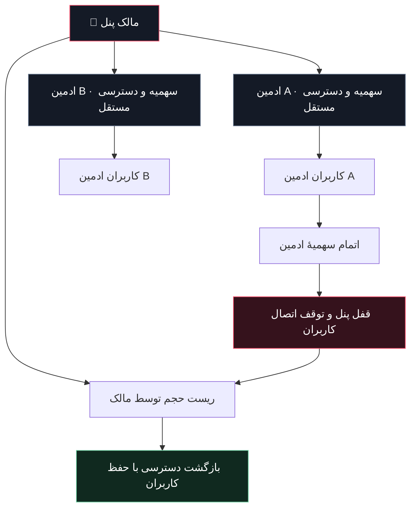

<div align="center">

<h1>🦇 BATMAN PANEL</h1>
<h3>BLOODLINE · GLASS STUDIO</h3>
<p><b>مدیریت کاربران. اتصال‌های اختصاصی. کنترل در تاریکی.</b></p>

<p>
  
  
  
  
</p>

<p>
  <a href="https://www.youtube.com/@Batman-V-P-N"></a>
  <a href="https://github.com/Batman-panel"></a>
  <a href="https://t.me/BATMAN_Pane_L"></a>
</p>

<p>
  <a href="#features">امکانات</a> ·
  <a href="#quick-start">نصب سریع</a> ·
  <a href="#falix">نصب روی Falix</a> ·
  <a href="#protocols">پروتکل‌ها</a> ·
  <a href="#admins">ادمین‌ها</a> ·
  <a href="#troubleshooting">رفع اشکال</a>
</p>

<hr>

<p><b>ONE CONSOLE. MANY ROUTES. YOUR RULES.</b></p>

</div>

## 🌑 گاتهام، زیر کنترل تو

**Batman Panel** یک پنل Node.js برای مدیریت کاربران، اشتراک‌ها و مسیرهای اتصال است؛ با رابط فارسی، طراحی تیره و شیشه‌ای، صفحهٔ اختصاصی اشتراک و پنل مستقل برای ادمین‌های فرعی.

کد اجرایی پروژه در **دو فایل** توزیع می‌شود. رابط کاربری، پلیر و تصاویر در `index.js` جاسازی شده‌اند؛ پوشهٔ جداگانهٔ frontend یا CDN تصویر لازم نیست. هسته‌های شبکه، داده‌ها و گواهی‌ها هنگام اجرا در مسیر دادهٔ سرور نگه‌داری می‌شوند.

> **نسخهٔ فعلی: `3.0.1` — Falix Compatibility Build**  
> نسخهٔ سبک‌تر با راه‌اندازی زودهنگام پنل وب، تشخیص پورت اختصاصی میزبان و پیام‌های تشخیصی شروع. سازگاری روی هر سرویس باید با منابع، مجوزها و تنظیمات همان میزبان بررسی شود.

<a id="features"></a>
## ✨ امکانات

| بخش | آنچه در اختیار داری |
| :--- | :--- |
| 🩸 **BATMAN BLOODLINE** | بتمن در مرکز تصویر، پس‌زمینهٔ واضح‌تر و پنل شفاف و شیشه‌ای |
| 🎨 **شخصی‌سازی** | هشت پس‌زمینهٔ انتخابی، حالت کاهش حرکت و ذخیرهٔ تنظیمات ظاهری در مرورگر |
| 👥 **مدیریت کاربران** | ساخت، ویرایش، حذف، سهمیهٔ حجمی، اعتبار زمانی، ریست مصرف و بازتولید اطلاعات اتصال |
| 🎛️ **پروتکل هر کاربر** | انتخاب مسیرهای مجاز در ساخت و ویرایش کاربر؛ بدون سقف تعداد کانفیگ در خروجیِ مسیرهای فعال و سازگار |
| 🔗 **مرکز لینک اشتراک** | لینک اختصاصی، کپی سریع، QR و خروجی‌های متناسب با کلاینت |
| 💎 **صفحهٔ ساب** | رابط مستقل، حلقهٔ مصرف، حجم باقی‌مانده، انقضا، فیلتر پروتکل و دریافت کانفیگ |
| ♜ **ادمین‌های مستقل** | ورود جداگانه، کاربران جدا، پروتکل‌های مجاز و سقف تعداد و حجم |
| 📊 **سلامت سرویس** | نمودار زمان پاسخ پنل، نمایش منابع، وضعیت هسته‌ها و پاسخ‌گویی پورت‌های محلی |
| 🎧 **پلیر داخلی** | هفت آهنگ، انتخاب مستقیم، قبلی/بعدی، کنترل صدا، جابه‌جایی در آهنگ و روشن/خاموش‌کردن |
| 💾 **ماندگاری داده** | ذخیرهٔ کاربران، تنظیمات و اطلاعات ادمین‌ها در مسیر دادهٔ سرور |
| 📱 **رابط واکنش‌گرا** | چیدمان دسکتاپ و موبایل، ناوبری بخش‌ها و کنترل‌های متناسب با صفحه |

### 🩸 حالت Bloodline

با فعال‌کردن Bloodline:

- ظاهر به نمای شیشه‌ای با تصویر مرکزی بتمن تغییر می‌کند.
- باران و جلوه‌های متحرک متوقف می‌شوند.
- فاصلهٔ به‌روزرسانی خودکار داشبورد از **۵ به ۲۰ ثانیه** افزایش می‌یابد.
- در تب مخفی، به‌روزرسانی خودکار داشبورد متوقف می‌شود.
- آهنگ ششم انتخاب می‌شود؛ اگر موسیقی را خاموش کرده باشی، اجباری پخش نمی‌شود.

**Bloodline حالت سبک‌ترِ رابط است؛ سهمیه‌ها را دور نمی‌زند و افزایش سرعت اینترنت را تضمین نمی‌کند.**

<a id="quick-start"></a>
## ⚡ نصب سریع

### پیش‌نیازها

- **Node.js 18 یا بالاتر**؛ برای نصب تازه، یک نسخهٔ LTS پشتیبانی‌شده توصیه می‌شود.
- فضای پایدار و قابل‌نوشتن برای داده‌ها.
- دسترسی شبکه برای دریافت اولیهٔ هسته‌های فعال‌شده.
- روی Linux، ابزارهای `tar`، `unzip` و `openssl` برای مسیرهای نصب و گواهی مرتبط.
- مجوز اجرای باینری‌ها و استفاده از پورت اختصاصی سرور.

دو فایل زیر را در پوشهٔ اجرای پروژه قرار بده:

```text
batman-panel/
├── index.js
├── package.json
└── README.md
```

سپس:

```bash
npm install
npm run check
npm start
```

آدرس پیش‌فرض، در صورت تنظیم‌نشدن پورت و مسیر سفارشی:

```text
http://YOUR-SERVER-IP:2705/batman
```

در نصب تازه، رمز مالک از صفحهٔ راه‌اندازی تعیین می‌شود. پیش از بازکردن نصب تازه روی اینترنت، یک **`PANEL_SETUP_KEY` قوی** در محیط سرور تنظیم کن.

> 🔐 برای انتشار عمومی، HTTPS پنل مدیریت و امنیت انتقال هر پروتکل را جداگانه تنظیم و بررسی کن. بازشدن صفحهٔ وب به‌تنهایی به معنی آماده‌بودن همهٔ مسیرهای VPN نیست.

<a id="falix"></a>
## 🟢 نصب روی Falix / Pterodactyl

### ۱. فایل‌ها را کامل آپلود کن

`index.js` و `package.json` باید مستقیماً داخل مسیر اجرای سرور باشند:

```text
/home/container/index.js
/home/container/package.json
```

فایل اجرایی را **دانلود و آپلود کن**؛ متن پیش‌نمایش فایل‌های بزرگ را در ویرایشگر کپی نکن.

### ۲. Startup را تنظیم کن

| گزینه | مقدار |
| :--- | :--- |
| Runtime | Node.js نسخهٔ سازگار؛ 18 یا بالاتر |
| `MAIN_FILE` | `index.js` |
| `NODE_ARGS` | برای اجرای معمول خالی؛ نباید `--batman-selftest` باشد |
| پورت | پورت اختصاصی خود سرور در پنل میزبان |

نسخهٔ `3.0.1` نخستین مقدار عددی معتبر را با این اولویت انتخاب می‌کند:

```text
SERVER_PORT → PORT → SB_PORT → پورت پیش‌فرض تنظیمات
```

### ۳. اولین پیام کنسول را بررسی کن

```text
[Batman 3.0.1] ENTRY LOADED | Node ... | .../index.js | ... bytes
```

سپس، در صورت موفقیت اتصال پورت:

```text
Batman web server started. Optional network engines are preparing.
```

در این نسخه، **پنل وب قبل از دانلود هسته‌ها** راه‌اندازی می‌شود. آماده‌بودن خود هسته‌ها را از بخش سلامت سرویس بررسی کن.

> روی هاست اشتراکی، داشتن یک پورت TCP لزوماً به معنی دسترسی UDP، امکان اجرای باینری یا پشتیبانی از همهٔ پروتکل‌ها نیست. قوانین و امکانات میزبان را بررسی کن.

<a id="configuration"></a>
## ⚙️ تنظیمات محیطی

تنظیمات را از بخش Environment / Startup میزبان یا متغیرهای محیطی سیستم تعیین کن. پروژه به بارگذاری خودکار فایل `.env` متکی نیست.

| متغیر | کاربرد |
| :--- | :--- |
| `SERVER_PORT` | پورت اختصاصی میزبان؛ اولویت اول در نسخهٔ فعلی |
| `PORT` / `SB_PORT` | گزینه‌های جایگزین پورت |
| `PANEL_PATH` | مسیر پنل؛ پیش‌فرض `batman` |
| `BK_DATA_DIR` | مسیر پایدار ذخیرهٔ کاربران، تنظیمات و هسته‌ها |
| `DOMAIN` | دامنه یا IP برای ساخت خروجی اتصال |
| `FORCE_HOST` | اولویت اجباری آدرس در کانفیگ‌ها |
| `PANEL_SETUP_KEY` | حفاظت از راه‌اندازی اولیهٔ رمز مالک |
| `ADMIN_PASSWORD` | تعیین رمز مالک از محیط؛ استفادهٔ دائمی از آن می‌تواند در هر شروع رمز را دوباره اعمال کند |
| `PANEL_TOKEN` | حفاظت اضافه از مسیرهای عمومی مدیریتی و خروجی مالک؛ جایگزین HTTPS و رمز ورود نیست |
| `ENABLE_HYSTERIA2` | فعال‌سازی Hysteria2 با `true` یا `false` |
| `ENABLE_XHTTP` | فعال‌سازی XHTTP؛ نیازمند هستهٔ Xray |
| `SHADOWTLS_SNI` | نام میزبان handshake مربوط به ShadowTLS |

نمونهٔ اجرای Linux برای نصب تازه:

```bash
export SERVER_PORT=2705
export PANEL_PATH=batman
export BK_DATA_DIR="$PWD/bk-data"
export DOMAIN="vpn.example.com"

# مقدار تولیدشده را خصوصی نگه دار.
export PANEL_SETUP_KEY="$(openssl rand -hex 24)"

npm start
```

در هاست مدیریت‌شده، `SERVER_PORT` را با پورت **تخصیص‌یافتهٔ همان سرویس** جایگزین کن. برای کاربران بیرونی، دامنه یا IP واقعی بده؛ `127.0.0.1` آدرس اتصال عمومی نیست.

<a id="protocols"></a>
## 🌐 پروتکل‌ها و خروجی‌ها

پروژه از یک مسیریاب عمومی برای هدایت اتصال‌ها به هسته‌های محلی استفاده می‌کند. **پروتکل، نوع انتقال و پورت سه مفهوم یکسان نیستند**؛ چند مسیر می‌توانند روی یک پورت عمومی ارائه شوند.

| مسیر | پروفایل مالک | ادمین فرعی حجمی | نکته |
| :--- | :---: | :---: | :--- |
| Hysteria2 | ✅ | — | نیازمند دسترسی UDP و هستهٔ آماده |
| VLESS · WebSocket | ✅ | ✅ | از مسیرهای قابل‌حسابداری رله |
| VLESS · HTTPUpgrade | ✅ | ✅ | نیازمند پشتیبانی کلاینت |
| VLESS · TCP | ✅ | ✅ | امنیت انتقال را جداگانه بررسی کن |
| Trojan · WebSocket | ✅ | ✅ | از مسیرهای قابل‌حسابداری رله |
| Trojan · TCP | ✅ | ✅ | از مسیرهای قابل‌حسابداری رله |
| VLESS · gRPC | ✅ | — | وابسته به هسته و سازگاری کلاینت |
| VMess · WebSocket | ✅ | — | وابسته به هسته و سازگاری کلاینت |
| VLESS over ShadowTLS | ✅ | — | از پروفایل کامل Sing-box JSON استفاده کن |
| Shadowsocks | ✅ | — | در معماری فعلی، مسیر دارای رمز مشترکِ مالک است |
| VLESS · XHTTP | اختیاری | — | نیازمند `ENABLE_XHTTP=true` و Xray |

**✅ یعنی مسیر در این نسخه پیاده‌سازی شده است، نه تضمین دسترسی روی هر شبکه و هر میزبان.** خروجی نهایی تابع هستهٔ فعال، انتخاب پروتکل کاربر و سازگاری فرمت است. مسیرهای فاقد هستهٔ آماده وارد خروجی عملیاتی نمی‌شوند.

### فرمت‌های اشتراک

| فرمت | استفاده |
| :--- | :--- |
| **Base64** | اشتراک معمول برای کلاینت‌های سازگار |
| **Full Base64** | خروجی کامل‌تر از URIهای قابل‌انتشار |
| **Raw / Full Raw** | فهرست متنی کانفیگ‌ها |
| **Sing-box JSON** | پروفایل JSON، شامل مسیر لایه‌ای ShadowTLS |
| **Clash Meta YAML** | مسیرهای دارای خروجی سازگار با Clash Meta |
| **QR** | انتقال لینک یا کانفیگ بدون تایپ دستی |

برای ShadowTLS، یک URI ناقص جایگزین زنجیرهٔ کامل VLESS-over-ShadowTLS نمی‌شود؛ این مسیر از خروجی مستقل raw/base64 حذف شده و پروفایل JSON کامل آن در دسترس است.

<a id="admins"></a>
## ♜ ادمین‌های مستقل، با مرز واقعی دسترسی

مالک می‌تواند از بخش **ادمین‌ها**، پنل فرعی بسازد و این موارد را تعیین کند:

- نام ادمین و رمز ورود مستقل؛
- حجم کل پنل بر اساس مصرف ثبت‌شدهٔ کاربران آن؛
- سقف تعداد کاربران؛
- سقف حجم قابل‌تخصیص به هر کاربر؛
- پروتکل‌های مجاز؛
- فعال یا متوقف‌بودن پنل.



### چرخهٔ سهمیه

1. مصرف عبوری از رله‌های قابل‌حسابداری به پنل ادمین مربوط ثبت می‌شود.
2. با اتمام سهمیه، پنل ادمین قفل و اتصال کاربران وابسته متوقف می‌شود.
3. کاربران، تنظیمات و اطلاعات اتصال حذف نمی‌شوند.
4. مالک می‌تواند مصرف پنل ادمین را ریست کند.
5. کاربرانی که سهمیه و اعتبار شخصی‌شان باقی مانده، دوباره امکان اتصال دارند.

ریست مصرف یک کاربر یا حذف او، **مصرف ثبت‌شدهٔ پنل ادمین را پس نمی‌دهد**. همچنین ریست حجم ادمین، سهمیهٔ شخصیِ تمام‌شدهٔ کاربران را خودکار صفر نمی‌کند.

> ادمین‌های فرعی فعلاً به **پنج مسیر TCP قابل‌حسابداریِ جدول بالا** محدودند. اندازه‌گیری بر مبنای بایت‌های عبوری رله است و می‌تواند سربار انتقال را هم شامل شود؛ برابر با حجم خالص فایل دانلودشده فرض نشود. مسیرهای فاقد حسابداری قابل‌اتکا عمداً به ادمین حجمی واگذار نمی‌شوند.

<a id="music"></a>
## 🎧 Gotham Frequencies

پلیر داخلی هفت آهنگ دارد و با رابط پنل یکپارچه است:

- آهنگ دوم در اولین ورود انتخاب می‌شود.
- صدای اولیه **۱۲٪** است.
- انتخاب آهنگ، پخش/توقف، قبلی/بعدی و کنترل صدا در دسترس است.
- در Bloodline آهنگ ششم انتخاب می‌شود و هنگام خروج، انتخاب قبلی بازمی‌گردد.
- خاموش‌کردن موسیقی از تنظیمات امکان‌پذیر است.
- تنظیمات موسیقی در همان مرورگر ذخیره می‌شود.

مرورگر ممکن است پخش خودکار صدادار را تا اولین لمس یا کلیک مسدود کند. فایل‌های صوتی از لینک‌های خارجی پخش می‌شوند؛ موجودبودن، مجوز استفاده و دسترسی شبکه به آن‌ها مستقل از خود پنل است.

<a id="health"></a>
## 📊 سلامت، بدون خروج از پنل

بخش سلامت سرویس شامل این موارد است:

- زمان پاسخ پنل و نمودار نمونه‌های اندازه‌گیری‌شده؛
- وضعیت فرایندهای هسته؛
- پاسخ‌گویی پورت‌های محلی؛
- نمایش CPU، حافظه و فضای دادهٔ قابل‌اندازه‌گیری؛
- وضعیت API آمار، در صورت پشتیبانی هسته.

این بخش یک **بررسی داخلی سرویس** است؛ جایگزین تست اتصال از اینترنت، سنجش UDP بیرونی یا دسترسی مدیریتی به زیرساخت میزبان نیست. شاخص‌ها با توجه به اطلاعات قابل‌مشاهدهٔ سیستم یا کانتینر ارائه می‌شوند.

<a id="storage"></a>
## 💾 داده‌ها و ارتقای امن

مسیر پیش‌فرض روی محیط کانتینری:

```text
/home/container/bk-data/
├── state.json
├── users.json
├── panel-settings.json
├── resellers.json
├── bin/
├── cert/
└── ...
```

مسیر واقعی را می‌توان با `BK_DATA_DIR` تغییر داد و هنگام شروع در کنسول مشاهده کرد. **این فایل‌ها در زمان اجرا تولید می‌شوند؛ دو فایل اجرایی به معنی نبودن فایل داده نیست.**

### ارتقای نسخه

1. سرویس را متوقف کن.
2. از **کل مسیر داده** و فایل‌های نسخهٔ فعلی بکاپ بگیر.
3. فقط `index.js` و `package.json` را جایگزین کن.
4. مسیر داده و متغیرهای محیطی قبلی را حفظ کن.
5. سرویس را شروع و ورود مالک، اشتراک‌ها و وضعیت ادمین‌ها را بررسی کن.

> بکاپ کاربران داخل پنل را معادل بکاپ کامل نصب فرض نکن. برای حفظ ادمین‌ها، سهمیه‌ها، کلیدها و تنظیمات، از **کل پوشهٔ داده‌ها** نسخهٔ امن نگه دار. این پوشه را هرگز در مخزن عمومی GitHub آپلود نکن.

<a id="security"></a>
## 🔐 پیش از انتشار عمومی

- پنل مدیریت و ورود ادمین‌ها را پشت **HTTPS معتبر** قرار بده.
- در نصب تازه، `PANEL_SETUP_KEY` را پیش از در دسترس قرارگرفتن پنل تنظیم کن.
- رمز مدیر، توکن نشست، لینک ساب و فایل بکاپ را منتشر نکن.
- فایل‌های `users.json`، `resellers.json` و پوشهٔ گواهی‌ها را خصوصی نگه دار.
- بعضی خروجی‌های خام/WS بدون TLS هستند؛ صرف نام VLESS یا Trojan، رمزگذاری مناسب مسیر را تضمین نمی‌کند.
- بازبودن UDP، محدودیت فایروال و امکان اجرای هسته را روی میزبان بررسی کن.
- برخی باینری‌های Sing-box فاقد API اختیاری آمار V2Ray هستند؛ روی حسابداری Hysteria2 و کنترل سهمیهٔ UDP بدون بررسی مستقل تکیه نکن.
- اگر ذخیره‌سازی ادمین‌ها خراب یا غیرقابل‌نوشتن باشد، نسخهٔ فعلی دسترسی ادمین‌های فرعی را قفل می‌کند تا پنل مالک برای عیب‌یابی در دسترس بماند؛ فایل خراب خودکار پاک نمی‌شود.

### نمونهٔ `.gitignore`

موارد زیر را متناسب با محل واقعی داده‌ها در `.gitignore` مخزن قرار بده:

```gitignore
node_modules/
bk-data/
.env
.env.*
!.env.example
*.log
state.json
users.json
resellers.json
panel-settings.json
*.key
*.pem
```

این پروژه جایگزین ممیزی امنیتی، ابزار حسابداری مالی یا تضمین دسترسی در همهٔ شبکه‌ها نیست. استفاده باید مطابق قوانین و شرایط سرویس میزبان باشد.

<a id="tests"></a>
## 🧪 بررسی و تست

دستورهای موجود در بسته:

```bash
# بررسی نحو فایل
npm run check

# اجرای خودآزمایی داخلی
npm test
```

### بررسی‌های انجام‌شده در محیط توسعه

| بررسی | نتیجهٔ ثبت‌شده |
| :--- | :--- |
| خودآزمایی داخلی | موفق |
| ۴۲ بررسی API، جداسازی کاربران و سهمیه | موفق |
| رابط Chromium در دسکتاپ و موبایل | موفق؛ انتقال صوت در تست رابط شبیه‌سازی شد |
| عبور درخواست با هستهٔ واقعی روی ۱۰ مسیر فعال | موفق در محیط آزمایشی |
| ثبت ترافیک WebSocket، از جمله دادهٔ اولیه و شناسهٔ تکه‌تکه‌شده | موفق |
| اتمام سهمیه، قطع اتصال، قفل پنل و بازگشت پس از ریست مالک | موفق |
| شروع پنل پیش از دانلود هسته و انتخاب `SERVER_PORT` | موفق در اجرای محلی مشابه راه‌اندازی Falix |
| حفظ پنل مالک هنگام خرابی فایل ادمین‌ها | موفق در تست محلی |

بررسی‌های یکپارچه و مرورگر در محیط توسعه اجرا شده‌اند؛ `npm test` فقط خودآزمایی داخلیِ موجود در بسته را اجرا می‌کند. این جدول CI خودکار مخزن یا تأیید اجرا داخل حساب خصوصی Falix نیست. XHTTP/Xray، Argo، TUIC و WireGuard در این مجموعهٔ تست انتقال بررسی نشده‌اند.

<a id="troubleshooting"></a>
## 🛠️ رفع اشکال

<details>
<summary><b>سرور بلافاصله آفلاین می‌شود و پیام شروع دیده نمی‌شود</b></summary>

- `MAIN_FILE` باید دقیقاً `index.js` باشد.
- فایل را در مسیر اجرای اصلی بگذار، نه زیرپوشهٔ استخراج‌شدهٔ ZIP.
- از کامل‌بودن آپلود مطمئن شو؛ کپی‌کردن پیش‌نمایش فایل بزرگ ممکن است ناقص باشد.
- نسخهٔ Node و آرگومان‌های Startup را بررسی کن.
- خروج با کد `137`، `Killed` یا پیام heap می‌تواند نشانهٔ محدودیت حافظه باشد؛ محدودیت واقعی میزبان را بررسی کن.
- خطای نحوی را با `npm run check` پیدا کن.

بدون پیام `ENTRY LOADED` نمی‌توان مطمئن بود فایل جدید به مرحلهٔ اجرای برنامه رسیده است.

</details>

<details>
<summary><b>پنل باز می‌شود اما کانفیگ‌ها وصل نمی‌شوند</b></summary>

- وضعیت هسته‌ها را در بخش سلامت ببین.
- دامنه/IP و پورت خروجی باید به همین سرور اشاره کنند.
- بازشدن پنل وب به معنی آماده‌شدن هسته‌ها نیست.
- برای Hysteria2، دسترسی UDP ضروری است.
- کلاینت باید نوع انتقال و فرمت واردشده را پشتیبانی کند.
- پشتیبانی پروکسی یا CDN از HTTP، به معنی عبور تمام پروتکل‌ها نیست.

</details>

<details>
<summary><b>ادمین قفل شده ولی کاربرانش حذف نشده‌اند</b></summary>

این رفتار در اتمام سهمیه یا توقف ادمین مورد انتظار است. مالک باید حجم پنل یا وضعیت فعال‌بودن ادمین را بررسی کند. خطای ذخیره‌سازی ادمین‌ها هم می‌تواند دسترسی فرعی را قفل کند؛ در این حالت دیسک، مجوز فایل و بکاپ `resellers.json` را بررسی کن.

برای رفع مشکل، پوشهٔ داده‌ها را پاک نکن.

</details>

<details>
<summary><b>موسیقی خودکار پخش نمی‌شود</b></summary>

روی دکمهٔ پخش بزن، وضعیت روشن‌بودن موسیقی و صدای پلیر را بررسی کن. اگر لینک خارجی در دسترس نباشد، آهنگ دیگری انتخاب کن یا لینک اصلی را باز کن. مرورگر و سرور صوتی مستقل از خود پنل می‌توانند پخش را محدود کنند.

</details>

<details>
<summary><b>خطای EADDRINUSE یا EACCES دیده می‌شود</b></summary>

`EADDRINUSE` معمولاً به اشغال پورت مربوط است. `EACCES` می‌تواند از پورت یا مجوز فایل باشد. از پورت تخصیص‌یافتهٔ میزبان و مسیر دادهٔ قابل‌نوشتن استفاده کن و قبل از شروع نسخهٔ جدید، نمونهٔ قبلی را متوقف کن.

</details>

<a id="contributing"></a>
## 🤝 گزارش مشکل و مشارکت

برای گزارش قابل‌پیگیری، این اطلاعات را همراه مسئله بفرست:

- نسخهٔ پنل و Node.js؛
- نوع محیط اجرا و روش شروع برنامه؛
- مراحل بازتولید مشکل؛
- نتیجهٔ مورد انتظار و نتیجهٔ واقعی؛
- چند خط مرتبط از کنسول، با حذف رمز، توکن، لینک ساب و اطلاعات کاربران.

پیشنهادهای رابط کاربری، بهبود سازگاری میزبان و تست‌های بیشتر برای مسیرهای اتصال، ارزشمندند. آسیب‌پذیری امنیتی را با اطلاعات حساس در Issue عمومی منتشر نکن.

<a id="license"></a>
## 📄 مجوز و حقوق محتوا

مجوز پروژه در `package.json` با عنوان **MIT** معرفی شده است. اعلان‌های مجوز وابستگی‌های باندل‌شده در انتهای `index.js` حفظ شده‌اند.

این عنوان را به معنی مالکیت یا مجوز آزاد تصاویر، شخصیت بتمن، نام‌های تجاری یا فایل‌های صوتی فرض نکن. حقوق این محتواها متعلق به صاحبان مربوط است؛ پیش از بازنشر یا استفادهٔ تجاری، مجوزهای لازم را بررسی کن.

---

<div align="center">

<h3>🦇 CONTROL THE NIGHT.</h3>
<p><b>BATMAN PANEL · BLOODLINE</b></p>
<p>
  <a href="https://www.youtube.com/@Batman-V-P-N">YouTube</a> ·
  <a href="https://github.com/Batman-panel">GitHub</a> ·
  <a href="https://t.me/BATMAN_Pane_L">Telegram</a>
</p>
<p>اگر پروژه به کارت آمد، به مخزن ⭐ بده.</p>

</div>
