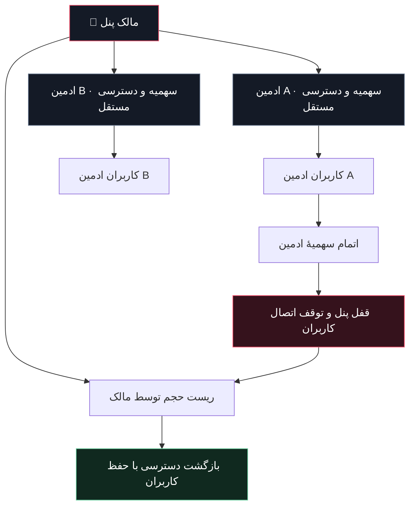

<div align="center">

<h1>🦇 BATMAN PANEL</h1>
<h3>BLOODLINE · GLASS STUDIO</h3>

<a id="languages"></a>
<p><b>🌐 Documentation / زبان مستندات / لغة التوثيق</b></p>
<p>
  <a href="#persian"><b>🇮🇷 فارسی</b></a> &nbsp; | &nbsp;
  <a href="#english"><b>🇬🇧 English</b></a> &nbsp; | &nbsp;
  <a href="#arabic"><b>🇸🇦 العربية</b></a>
</p>

<p><b>مدیریت کاربران. اتصال‌های اختصاصی. کنترل در تاریکی.</b></p>

<p>
  
  
  
  
</p>

<p>
  <a href="https://www.youtube.com/@Batman-V-P-N"></a>
  <a href="https://github.com/Batman-panel"></a>
  <a href="https://t.me/BATMAN_Pane_L"></a>
</p>

<p>
  <a href="#features">امکانات</a> ·
  <a href="#quick-start">نصب سریع</a> ·
  <a href="#falix">نصب روی Falix</a> ·
  <a href="#protocols">پروتکل‌ها</a> ·
  <a href="#admins">ادمین‌ها</a> ·
  <a href="#troubleshooting">رفع اشکال</a>
</p>

<hr>

<p><b>ONE CONSOLE. MANY ROUTES. YOUR RULES.</b></p>

</div>

<a id="persian"></a>

# 🇮🇷 فارسی

**فارسی** · [English](#english) · [العربية](#arabic) · [↑ انتخاب زبان](#languages)

> زبان‌های این فایل مربوط به مستندات هستند؛ این تغییر به‌تنهایی زبان جدیدی به رابط پنل اضافه نمی‌کند.

## 🌑 گاتهام، زیر کنترل تو

**Batman Panel** یک پنل Node.js برای مدیریت کاربران، اشتراک‌ها و مسیرهای اتصال است؛ با رابط فارسی، طراحی تیره و شیشه‌ای، صفحهٔ اختصاصی اشتراک و پنل مستقل برای ادمین‌های فرعی.

کد اجرایی پروژه در **دو فایل** توزیع می‌شود. رابط کاربری، پلیر و تصاویر در `index.js` جاسازی شده‌اند؛ پوشهٔ جداگانهٔ frontend یا CDN تصویر لازم نیست. هسته‌های شبکه، داده‌ها و گواهی‌ها هنگام اجرا در مسیر دادهٔ سرور نگه‌داری می‌شوند.

> **نسخهٔ فعلی: `3.0.1` — Falix Compatibility Build**  
> نسخهٔ سبک‌تر با راه‌اندازی زودهنگام پنل وب، تشخیص پورت اختصاصی میزبان و پیام‌های تشخیصی شروع. سازگاری روی هر سرویس باید با منابع، مجوزها و تنظیمات همان میزبان بررسی شود.

<a id="features"></a>
## ✨ امکانات

| بخش | آنچه در اختیار داری |
| :--- | :--- |
| 🩸 **BATMAN BLOODLINE** | بتمن در مرکز تصویر، پس‌زمینهٔ واضح‌تر و پنل شفاف و شیشه‌ای |
| 🎨 **شخصی‌سازی** | هشت پس‌زمینهٔ انتخابی، حالت کاهش حرکت و ذخیرهٔ تنظیمات ظاهری در مرورگر |
| 👥 **مدیریت کاربران** | ساخت، ویرایش، حذف، سهمیهٔ حجمی، اعتبار زمانی، ریست مصرف و بازتولید اطلاعات اتصال |
| 🎛️ **پروتکل هر کاربر** | انتخاب مسیرهای مجاز در ساخت و ویرایش کاربر؛ بدون سقف تعداد کانفیگ در خروجیِ مسیرهای فعال و سازگار |
| 🔗 **مرکز لینک اشتراک** | لینک اختصاصی، کپی سریع، QR و خروجی‌های متناسب با کلاینت |
| 💎 **صفحهٔ ساب** | رابط مستقل، حلقهٔ مصرف، حجم باقی‌مانده، انقضا، فیلتر پروتکل و دریافت کانفیگ |
| ♜ **ادمین‌های مستقل** | ورود جداگانه، کاربران جدا، پروتکل‌های مجاز و سقف تعداد و حجم |
| 📊 **سلامت سرویس** | نمودار زمان پاسخ پنل، نمایش منابع، وضعیت هسته‌ها و پاسخ‌گویی پورت‌های محلی |
| 🎧 **پلیر داخلی** | هفت آهنگ، انتخاب مستقیم، قبلی/بعدی، کنترل صدا، جابه‌جایی در آهنگ و روشن/خاموش‌کردن |
| 💾 **ماندگاری داده** | ذخیرهٔ کاربران، تنظیمات و اطلاعات ادمین‌ها در مسیر دادهٔ سرور |
| 📱 **رابط واکنش‌گرا** | چیدمان دسکتاپ و موبایل، ناوبری بخش‌ها و کنترل‌های متناسب با صفحه |

### 🩸 حالت Bloodline

با فعال‌کردن Bloodline:

- ظاهر به نمای شیشه‌ای با تصویر مرکزی بتمن تغییر می‌کند.
- باران و جلوه‌های متحرک متوقف می‌شوند.
- فاصلهٔ به‌روزرسانی خودکار داشبورد از **۵ به ۲۰ ثانیه** افزایش می‌یابد.
- در تب مخفی، به‌روزرسانی خودکار داشبورد متوقف می‌شود.
- آهنگ ششم انتخاب می‌شود؛ اگر موسیقی را خاموش کرده باشی، اجباری پخش نمی‌شود.

**Bloodline حالت سبک‌ترِ رابط است؛ سهمیه‌ها را دور نمی‌زند و افزایش سرعت اینترنت را تضمین نمی‌کند.**

<a id="quick-start"></a>
## ⚡ نصب سریع

### پیش‌نیازها

- **Node.js 18 یا بالاتر**؛ برای نصب تازه، یک نسخهٔ LTS پشتیبانی‌شده توصیه می‌شود.
- فضای پایدار و قابل‌نوشتن برای داده‌ها.
- دسترسی شبکه برای دریافت اولیهٔ هسته‌های فعال‌شده.
- روی Linux، ابزارهای `tar`، `unzip` و `openssl` برای مسیرهای نصب و گواهی مرتبط.
- مجوز اجرای باینری‌ها و استفاده از پورت اختصاصی سرور.

دو فایل زیر را در پوشهٔ اجرای پروژه قرار بده:

```text
batman-panel/
├── index.js
├── package.json
└── README.md
```

سپس:

```bash
npm install
npm run check
npm start
```

آدرس پیش‌فرض، در صورت تنظیم‌نشدن پورت و مسیر سفارشی:

```text
http://YOUR-SERVER-IP:2705/batman
```

در نصب تازه، رمز مالک از صفحهٔ راه‌اندازی تعیین می‌شود. پیش از بازکردن نصب تازه روی اینترنت، یک **`PANEL_SETUP_KEY` قوی** در محیط سرور تنظیم کن.

> 🔐 برای انتشار عمومی، HTTPS پنل مدیریت و امنیت انتقال هر پروتکل را جداگانه تنظیم و بررسی کن. بازشدن صفحهٔ وب به‌تنهایی به معنی آماده‌بودن همهٔ مسیرهای VPN نیست.

<a id="falix"></a>
## 🟢 نصب روی Falix / Pterodactyl

### ۱. فایل‌ها را کامل آپلود کن

`index.js` و `package.json` باید مستقیماً داخل مسیر اجرای سرور باشند:

```text
/home/container/index.js
/home/container/package.json
```

فایل اجرایی را **دانلود و آپلود کن**؛ متن پیش‌نمایش فایل‌های بزرگ را در ویرایشگر کپی نکن.

### ۲. Startup را تنظیم کن

| گزینه | مقدار |
| :--- | :--- |
| Runtime | Node.js نسخهٔ سازگار؛ 18 یا بالاتر |
| `MAIN_FILE` | `index.js` |
| `NODE_ARGS` | برای اجرای معمول خالی؛ نباید `--batman-selftest` باشد |
| پورت | پورت اختصاصی خود سرور در پنل میزبان |

نسخهٔ `3.0.1` نخستین مقدار عددی معتبر را با این اولویت انتخاب می‌کند:

```text
SERVER_PORT → PORT → SB_PORT → پورت پیش‌فرض تنظیمات
```

### ۳. اولین پیام کنسول را بررسی کن

```text
[Batman 3.0.1] ENTRY LOADED | Node ... | .../index.js | ... bytes
```

سپس، در صورت موفقیت اتصال پورت:

```text
Batman web server started. Optional network engines are preparing.
```

در این نسخه، **پنل وب قبل از دانلود هسته‌ها** راه‌اندازی می‌شود. آماده‌بودن خود هسته‌ها را از بخش سلامت سرویس بررسی کن.

> روی هاست اشتراکی، داشتن یک پورت TCP لزوماً به معنی دسترسی UDP، امکان اجرای باینری یا پشتیبانی از همهٔ پروتکل‌ها نیست. قوانین و امکانات میزبان را بررسی کن.

<a id="configuration"></a>
## ⚙️ تنظیمات محیطی

تنظیمات را از بخش Environment / Startup میزبان یا متغیرهای محیطی سیستم تعیین کن. پروژه به بارگذاری خودکار فایل `.env` متکی نیست.

| متغیر | کاربرد |
| :--- | :--- |
| `SERVER_PORT` | پورت اختصاصی میزبان؛ اولویت اول در نسخهٔ فعلی |
| `PORT` / `SB_PORT` | گزینه‌های جایگزین پورت |
| `PANEL_PATH` | مسیر پنل؛ پیش‌فرض `batman` |
| `BK_DATA_DIR` | مسیر پایدار ذخیرهٔ کاربران، تنظیمات و هسته‌ها |
| `DOMAIN` | دامنه یا IP برای ساخت خروجی اتصال |
| `FORCE_HOST` | اولویت اجباری آدرس در کانفیگ‌ها |
| `PANEL_SETUP_KEY` | حفاظت از راه‌اندازی اولیهٔ رمز مالک |
| `ADMIN_PASSWORD` | تعیین رمز مالک از محیط؛ استفادهٔ دائمی از آن می‌تواند در هر شروع رمز را دوباره اعمال کند |
| `PANEL_TOKEN` | حفاظت اضافه از مسیرهای عمومی مدیریتی و خروجی مالک؛ جایگزین HTTPS و رمز ورود نیست |
| `ENABLE_HYSTERIA2` | فعال‌سازی Hysteria2 با `true` یا `false` |
| `ENABLE_XHTTP` | فعال‌سازی XHTTP؛ نیازمند هستهٔ Xray |
| `SHADOWTLS_SNI` | نام میزبان handshake مربوط به ShadowTLS |

نمونهٔ اجرای Linux برای نصب تازه:

```bash
export SERVER_PORT=2705
export PANEL_PATH=batman
export BK_DATA_DIR="$PWD/bk-data"
export DOMAIN="vpn.example.com"

# مقدار تولیدشده را خصوصی نگه دار.
export PANEL_SETUP_KEY="$(openssl rand -hex 24)"

npm start
```

در هاست مدیریت‌شده، `SERVER_PORT` را با پورت **تخصیص‌یافتهٔ همان سرویس** جایگزین کن. برای کاربران بیرونی، دامنه یا IP واقعی بده؛ `127.0.0.1` آدرس اتصال عمومی نیست.

<a id="protocols"></a>
## 🌐 پروتکل‌ها و خروجی‌ها

پروژه از یک مسیریاب عمومی برای هدایت اتصال‌ها به هسته‌های محلی استفاده می‌کند. **پروتکل، نوع انتقال و پورت سه مفهوم یکسان نیستند**؛ چند مسیر می‌توانند روی یک پورت عمومی ارائه شوند.

| مسیر | پروفایل مالک | ادمین فرعی حجمی | نکته |
| :--- | :---: | :---: | :--- |
| Hysteria2 | ✅ | — | نیازمند دسترسی UDP و هستهٔ آماده |
| VLESS · WebSocket | ✅ | ✅ | از مسیرهای قابل‌حسابداری رله |
| VLESS · HTTPUpgrade | ✅ | ✅ | نیازمند پشتیبانی کلاینت |
| VLESS · TCP | ✅ | ✅ | امنیت انتقال را جداگانه بررسی کن |
| Trojan · WebSocket | ✅ | ✅ | از مسیرهای قابل‌حسابداری رله |
| Trojan · TCP | ✅ | ✅ | از مسیرهای قابل‌حسابداری رله |
| VLESS · gRPC | ✅ | — | وابسته به هسته و سازگاری کلاینت |
| VMess · WebSocket | ✅ | — | وابسته به هسته و سازگاری کلاینت |
| VLESS over ShadowTLS | ✅ | — | از پروفایل کامل Sing-box JSON استفاده کن |
| Shadowsocks | ✅ | — | در معماری فعلی، مسیر دارای رمز مشترکِ مالک است |
| VLESS · XHTTP | اختیاری | — | نیازمند `ENABLE_XHTTP=true` و Xray |

**✅ یعنی مسیر در این نسخه پیاده‌سازی شده است، نه تضمین دسترسی روی هر شبکه و هر میزبان.** خروجی نهایی تابع هستهٔ فعال، انتخاب پروتکل کاربر و سازگاری فرمت است. مسیرهای فاقد هستهٔ آماده وارد خروجی عملیاتی نمی‌شوند.

### فرمت‌های اشتراک

| فرمت | استفاده |
| :--- | :--- |
| **Base64** | اشتراک معمول برای کلاینت‌های سازگار |
| **Full Base64** | خروجی کامل‌تر از URIهای قابل‌انتشار |
| **Raw / Full Raw** | فهرست متنی کانفیگ‌ها |
| **Sing-box JSON** | پروفایل JSON، شامل مسیر لایه‌ای ShadowTLS |
| **Clash Meta YAML** | مسیرهای دارای خروجی سازگار با Clash Meta |
| **QR** | انتقال لینک یا کانفیگ بدون تایپ دستی |

برای ShadowTLS، یک URI ناقص جایگزین زنجیرهٔ کامل VLESS-over-ShadowTLS نمی‌شود؛ این مسیر از خروجی مستقل raw/base64 حذف شده و پروفایل JSON کامل آن در دسترس است.

<a id="admins"></a>
## ♜ ادمین‌های مستقل، با مرز واقعی دسترسی

مالک می‌تواند از بخش **ادمین‌ها**، پنل فرعی بسازد و این موارد را تعیین کند:

- نام ادمین و رمز ورود مستقل؛
- حجم کل پنل بر اساس مصرف ثبت‌شدهٔ کاربران آن؛
- سقف تعداد کاربران؛
- سقف حجم قابل‌تخصیص به هر کاربر؛
- پروتکل‌های مجاز؛
- فعال یا متوقف‌بودن پنل.



### چرخهٔ سهمیه

1. مصرف عبوری از رله‌های قابل‌حسابداری به پنل ادمین مربوط ثبت می‌شود.
2. با اتمام سهمیه، پنل ادمین قفل و اتصال کاربران وابسته متوقف می‌شود.
3. کاربران، تنظیمات و اطلاعات اتصال حذف نمی‌شوند.
4. مالک می‌تواند مصرف پنل ادمین را ریست کند.
5. کاربرانی که سهمیه و اعتبار شخصی‌شان باقی مانده، دوباره امکان اتصال دارند.

ریست مصرف یک کاربر یا حذف او، **مصرف ثبت‌شدهٔ پنل ادمین را پس نمی‌دهد**. همچنین ریست حجم ادمین، سهمیهٔ شخصیِ تمام‌شدهٔ کاربران را خودکار صفر نمی‌کند.

> ادمین‌های فرعی فعلاً به **پنج مسیر TCP قابل‌حسابداریِ جدول بالا** محدودند. اندازه‌گیری بر مبنای بایت‌های عبوری رله است و می‌تواند سربار انتقال را هم شامل شود؛ برابر با حجم خالص فایل دانلودشده فرض نشود. مسیرهای فاقد حسابداری قابل‌اتکا عمداً به ادمین حجمی واگذار نمی‌شوند.

<a id="music"></a>
## 🎧 Gotham Frequencies

پلیر داخلی هفت آهنگ دارد و با رابط پنل یکپارچه است:

- آهنگ دوم در اولین ورود انتخاب می‌شود.
- صدای اولیه **۱۲٪** است.
- انتخاب آهنگ، پخش/توقف، قبلی/بعدی و کنترل صدا در دسترس است.
- در Bloodline آهنگ ششم انتخاب می‌شود و هنگام خروج، انتخاب قبلی بازمی‌گردد.
- خاموش‌کردن موسیقی از تنظیمات امکان‌پذیر است.
- تنظیمات موسیقی در همان مرورگر ذخیره می‌شود.

مرورگر ممکن است پخش خودکار صدادار را تا اولین لمس یا کلیک مسدود کند. فایل‌های صوتی از لینک‌های خارجی پخش می‌شوند؛ موجودبودن، مجوز استفاده و دسترسی شبکه به آن‌ها مستقل از خود پنل است.

<a id="health"></a>
## 📊 سلامت، بدون خروج از پنل

بخش سلامت سرویس شامل این موارد است:

- زمان پاسخ پنل و نمودار نمونه‌های اندازه‌گیری‌شده؛
- وضعیت فرایندهای هسته؛
- پاسخ‌گویی پورت‌های محلی؛
- نمایش CPU، حافظه و فضای دادهٔ قابل‌اندازه‌گیری؛
- وضعیت API آمار، در صورت پشتیبانی هسته.

این بخش یک **بررسی داخلی سرویس** است؛ جایگزین تست اتصال از اینترنت، سنجش UDP بیرونی یا دسترسی مدیریتی به زیرساخت میزبان نیست. شاخص‌ها با توجه به اطلاعات قابل‌مشاهدهٔ سیستم یا کانتینر ارائه می‌شوند.

<a id="storage"></a>
## 💾 داده‌ها و ارتقای امن

مسیر پیش‌فرض روی محیط کانتینری:

```text
/home/container/bk-data/
├── state.json
├── users.json
├── panel-settings.json
├── resellers.json
├── bin/
├── cert/
└── ...
```

مسیر واقعی را می‌توان با `BK_DATA_DIR` تغییر داد و هنگام شروع در کنسول مشاهده کرد. **این فایل‌ها در زمان اجرا تولید می‌شوند؛ دو فایل اجرایی به معنی نبودن فایل داده نیست.**

### ارتقای نسخه

1. سرویس را متوقف کن.
2. از **کل مسیر داده** و فایل‌های نسخهٔ فعلی بکاپ بگیر.
3. فقط `index.js` و `package.json` را جایگزین کن.
4. مسیر داده و متغیرهای محیطی قبلی را حفظ کن.
5. سرویس را شروع و ورود مالک، اشتراک‌ها و وضعیت ادمین‌ها را بررسی کن.

> بکاپ کاربران داخل پنل را معادل بکاپ کامل نصب فرض نکن. برای حفظ ادمین‌ها، سهمیه‌ها، کلیدها و تنظیمات، از **کل پوشهٔ داده‌ها** نسخهٔ امن نگه دار. این پوشه را هرگز در مخزن عمومی GitHub آپلود نکن.

<a id="security"></a>
## 🔐 پیش از انتشار عمومی

- پنل مدیریت و ورود ادمین‌ها را پشت **HTTPS معتبر** قرار بده.
- در نصب تازه، `PANEL_SETUP_KEY` را پیش از در دسترس قرارگرفتن پنل تنظیم کن.
- رمز مدیر، توکن نشست، لینک ساب و فایل بکاپ را منتشر نکن.
- فایل‌های `users.json`، `resellers.json` و پوشهٔ گواهی‌ها را خصوصی نگه دار.
- بعضی خروجی‌های خام/WS بدون TLS هستند؛ صرف نام VLESS یا Trojan، رمزگذاری مناسب مسیر را تضمین نمی‌کند.
- بازبودن UDP، محدودیت فایروال و امکان اجرای هسته را روی میزبان بررسی کن.
- برخی باینری‌های Sing-box فاقد API اختیاری آمار V2Ray هستند؛ روی حسابداری Hysteria2 و کنترل سهمیهٔ UDP بدون بررسی مستقل تکیه نکن.
- اگر ذخیره‌سازی ادمین‌ها خراب یا غیرقابل‌نوشتن باشد، نسخهٔ فعلی دسترسی ادمین‌های فرعی را قفل می‌کند تا پنل مالک برای عیب‌یابی در دسترس بماند؛ فایل خراب خودکار پاک نمی‌شود.

### نمونهٔ `.gitignore`

موارد زیر را متناسب با محل واقعی داده‌ها در `.gitignore` مخزن قرار بده:

```gitignore
node_modules/
bk-data/
.env
.env.*
!.env.example
*.log
state.json
users.json
resellers.json
panel-settings.json
*.key
*.pem
```

این پروژه جایگزین ممیزی امنیتی، ابزار حسابداری مالی یا تضمین دسترسی در همهٔ شبکه‌ها نیست. استفاده باید مطابق قوانین و شرایط سرویس میزبان باشد.

<a id="tests"></a>
## 🧪 بررسی و تست

دستورهای موجود در بسته:

```bash
# بررسی نحو فایل
npm run check

# اجرای خودآزمایی داخلی
npm test
```

### بررسی‌های انجام‌شده در محیط توسعه

| بررسی | نتیجهٔ ثبت‌شده |
| :--- | :--- |
| خودآزمایی داخلی | موفق |
| ۴۲ بررسی API، جداسازی کاربران و سهمیه | موفق |
| رابط Chromium در دسکتاپ و موبایل | موفق؛ انتقال صوت در تست رابط شبیه‌سازی شد |
| عبور درخواست با هستهٔ واقعی روی ۱۰ مسیر فعال | موفق در محیط آزمایشی |
| ثبت ترافیک WebSocket، از جمله دادهٔ اولیه و شناسهٔ تکه‌تکه‌شده | موفق |
| اتمام سهمیه، قطع اتصال، قفل پنل و بازگشت پس از ریست مالک | موفق |
| شروع پنل پیش از دانلود هسته و انتخاب `SERVER_PORT` | موفق در اجرای محلی مشابه راه‌اندازی Falix |
| حفظ پنل مالک هنگام خرابی فایل ادمین‌ها | موفق در تست محلی |

بررسی‌های یکپارچه و مرورگر در محیط توسعه اجرا شده‌اند؛ `npm test` فقط خودآزمایی داخلیِ موجود در بسته را اجرا می‌کند. این جدول CI خودکار مخزن یا تأیید اجرا داخل حساب خصوصی Falix نیست. XHTTP/Xray، Argo، TUIC و WireGuard در این مجموعهٔ تست انتقال بررسی نشده‌اند.

<a id="troubleshooting"></a>
## 🛠️ رفع اشکال

<details>
<summary><b>سرور بلافاصله آفلاین می‌شود و پیام شروع دیده نمی‌شود</b></summary>

- `MAIN_FILE` باید دقیقاً `index.js` باشد.
- فایل را در مسیر اجرای اصلی بگذار، نه زیرپوشهٔ استخراج‌شدهٔ ZIP.
- از کامل‌بودن آپلود مطمئن شو؛ کپی‌کردن پیش‌نمایش فایل بزرگ ممکن است ناقص باشد.
- نسخهٔ Node و آرگومان‌های Startup را بررسی کن.
- خروج با کد `137`، `Killed` یا پیام heap می‌تواند نشانهٔ محدودیت حافظه باشد؛ محدودیت واقعی میزبان را بررسی کن.
- خطای نحوی را با `npm run check` پیدا کن.

بدون پیام `ENTRY LOADED` نمی‌توان مطمئن بود فایل جدید به مرحلهٔ اجرای برنامه رسیده است.

</details>

<details>
<summary><b>پنل باز می‌شود اما کانفیگ‌ها وصل نمی‌شوند</b></summary>

- وضعیت هسته‌ها را در بخش سلامت ببین.
- دامنه/IP و پورت خروجی باید به همین سرور اشاره کنند.
- بازشدن پنل وب به معنی آماده‌شدن هسته‌ها نیست.
- برای Hysteria2، دسترسی UDP ضروری است.
- کلاینت باید نوع انتقال و فرمت واردشده را پشتیبانی کند.
- پشتیبانی پروکسی یا CDN از HTTP، به معنی عبور تمام پروتکل‌ها نیست.

</details>

<details>
<summary><b>ادمین قفل شده ولی کاربرانش حذف نشده‌اند</b></summary>

این رفتار در اتمام سهمیه یا توقف ادمین مورد انتظار است. مالک باید حجم پنل یا وضعیت فعال‌بودن ادمین را بررسی کند. خطای ذخیره‌سازی ادمین‌ها هم می‌تواند دسترسی فرعی را قفل کند؛ در این حالت دیسک، مجوز فایل و بکاپ `resellers.json` را بررسی کن.

برای رفع مشکل، پوشهٔ داده‌ها را پاک نکن.

</details>

<details>
<summary><b>موسیقی خودکار پخش نمی‌شود</b></summary>

روی دکمهٔ پخش بزن، وضعیت روشن‌بودن موسیقی و صدای پلیر را بررسی کن. اگر لینک خارجی در دسترس نباشد، آهنگ دیگری انتخاب کن یا لینک اصلی را باز کن. مرورگر و سرور صوتی مستقل از خود پنل می‌توانند پخش را محدود کنند.

</details>

<details>
<summary><b>خطای EADDRINUSE یا EACCES دیده می‌شود</b></summary>

`EADDRINUSE` معمولاً به اشغال پورت مربوط است. `EACCES` می‌تواند از پورت یا مجوز فایل باشد. از پورت تخصیص‌یافتهٔ میزبان و مسیر دادهٔ قابل‌نوشتن استفاده کن و قبل از شروع نسخهٔ جدید، نمونهٔ قبلی را متوقف کن.

</details>

<a id="contributing"></a>
## 🤝 گزارش مشکل و مشارکت

برای گزارش قابل‌پیگیری، این اطلاعات را همراه مسئله بفرست:

- نسخهٔ پنل و Node.js؛
- نوع محیط اجرا و روش شروع برنامه؛
- مراحل بازتولید مشکل؛
- نتیجهٔ مورد انتظار و نتیجهٔ واقعی؛
- چند خط مرتبط از کنسول، با حذف رمز، توکن، لینک ساب و اطلاعات کاربران.

پیشنهادهای رابط کاربری، بهبود سازگاری میزبان و تست‌های بیشتر برای مسیرهای اتصال، ارزشمندند. آسیب‌پذیری امنیتی را با اطلاعات حساس در Issue عمومی منتشر نکن.

<a id="license"></a>
## 📄 مجوز و حقوق محتوا

مجوز پروژه در `package.json` با عنوان **MIT** معرفی شده است. اعلان‌های مجوز وابستگی‌های باندل‌شده در انتهای `index.js` حفظ شده‌اند.

این عنوان را به معنی مالکیت یا مجوز آزاد تصاویر، شخصیت بتمن، نام‌های تجاری یا فایل‌های صوتی فرض نکن. حقوق این محتواها متعلق به صاحبان مربوط است؛ پیش از بازنشر یا استفادهٔ تجاری، مجوزهای لازم را بررسی کن.

---

<div align="center">

<h3>🦇 CONTROL THE NIGHT.</h3>
<p><b>BATMAN PANEL · BLOODLINE</b></p>
<p>
  <a href="https://www.youtube.com/@Batman-V-P-N">YouTube</a> ·
  <a href="https://github.com/Batman-panel">GitHub</a> ·
  <a href="https://t.me/BATMAN_Pane_L">Telegram</a>
</p>
<p>اگر پروژه به کارت آمد، به مخزن ⭐ بده.</p>

</div>


[↑ انتخاب زبان](#languages)


---

<a id="english"></a>
# 🇬🇧 English

[فارسی](#persian) · **English** · [العربية](#arabic) · [↑ Language selector](#languages)

## 🦇 Batman Panel — Bloodline · Glass Studio

**One console. Many routes. Your rules.**

Batman Panel is a Node.js application for managing users, subscriptions and connection routes. It includes a dark glass-style interface, a dedicated subscription portal and isolated reseller accounts.

**Current release: `3.0.1` — Falix Compatibility Build.** This release reduces the entry-file size, starts the web listener before optional engine downloads and prioritizes the host-assigned port. Actual hosting compatibility still depends on available resources, permissions and network rules.

> These are documentation languages. They do not add new interface languages to the application.

## ✨ Features

| Area | Included |
| :--- | :--- |
| 🩸 Bloodline | Centered Batman artwork, translucent panels and reduced visual activity |
| 🎨 Appearance | Eight selectable backgrounds and browser-persisted preferences |
| 👥 Users | Creation, editing, deletion, traffic quota, expiry, usage reset and credential rotation |
| 🎛️ Protocol control | Per-user selection; no global subscription configuration-count cap for available, compatible routes |
| 🔗 Subscriptions | Private links, copy controls, QR codes and client-oriented exports |
| 💎 Public portal | Usage ring, remaining allowance, expiry, protocol filter and configuration download |
| ♜ Resellers | Separate login, isolated users, protocol permissions, account limits and traffic allowance |
| 📊 Service health | Measured response-time chart, resource metrics, engine state and local-port checks |
| 🎧 Audio | Seven tracks, play/pause, track selection, seeking, volume and an on/off setting |
| 📱 Responsive UI | Desktop and mobile layouts |

### Bloodline mode

Bloodline stops rain and animated effects, changes the automatic dashboard refresh interval from **5 to 20 seconds**, and selects track six. Automatic dashboard refresh pauses in a hidden tab. Disabled music stays disabled.

**This is a lighter interface mode—not a bandwidth boost, a quota bypass or a guarantee of faster VPN connections.**

## ⚡ Quick start

Requirements:

- Node.js **18 or later**; use a currently supported LTS release for a new installation.
- Persistent, writable storage and permission to execute the required engines.
- Initial network access to download enabled engines.
- On Linux, `tar`, `unzip` and `openssl` for the relevant installation and certificate operations.

Place the files in the application directory:

```text
batman-panel/
├── index.js
├── package.json
└── README.md
```

```bash
npm install
npm run check
npm start
```

Default address, unless overridden:

```text
http://YOUR-SERVER-IP:2705/batman
```

Set a strong `PANEL_SETUP_KEY` **before exposing a new installation**, then complete owner-password setup in the browser. Use HTTPS for public management access.

The executable application is distributed in **two source files**. Images, styles and interface scripts are embedded in `index.js`; engines, certificates and persistent data are separate runtime files.

## 🟢 Falix / Pterodactyl

1. Upload the complete files directly to `/home/container/index.js` and `/home/container/package.json`.
2. Set `MAIN_FILE` to `index.js`.
3. Leave `NODE_ARGS` empty for normal operation; do not use `--batman-selftest` as a production startup argument.
4. Keep the host-assigned port. Version `3.0.1` selects the first valid numeric value in this order:

```text
SERVER_PORT → PORT → SB_PORT → configured default
```

The console should first show:

```text
[Batman 3.0.1] ENTRY LOADED | Node ... | .../index.js | ... bytes
```

After a successful bind:

```text
Batman web server started. Optional network engines are preparing.
```

Download and upload the actual file rather than copying a large file preview. A working web page does **not** prove that every engine or transport is ready. A shared host may restrict UDP, executable binaries or network ports.

## ⚙️ Environment variables

Configure variables through your hosting panel or operating-system environment. Automatic loading of `.env` files is not assumed.

| Variable | Purpose |
| :--- | :--- |
| `SERVER_PORT` | Host-assigned port; highest priority |
| `PORT` / `SB_PORT` | Alternative port values |
| `PANEL_PATH` | Panel path; defaults to `batman` |
| `BK_DATA_DIR` | Persistent application-data directory |
| `DOMAIN` / `FORCE_HOST` | Public host used in configurations; `FORCE_HOST` takes precedence |
| `PANEL_SETUP_KEY` | Protects first-run owner setup |
| `ADMIN_PASSWORD` | Supplies the owner password; keeping it set can reapply the password at startup |
| `PANEL_TOKEN` | Additional protection for relevant owner routes; not a replacement for HTTPS |
| `ENABLE_HYSTERIA2` | Enables or disables Hysteria2 |
| `ENABLE_XHTTP` | Enables optional XHTTP; requires Xray |
| `SHADOWTLS_SNI` | ShadowTLS handshake hostname |

Example for a new Linux installation:

```bash
export SERVER_PORT=2705
export PANEL_PATH=batman
export BK_DATA_DIR="$PWD/bk-data"
export DOMAIN="vpn.example.com"
export PANEL_SETUP_KEY="$(openssl rand -hex 24)"
npm start
```

Use your actual allocated port and public address. `127.0.0.1` is not a usable server address for remote subscribers.

## 🌐 Protocols and exports

Multiple routes can share the public listener. A protocol, a transport and a port are not interchangeable terms.

| Route | Owner profile | Traffic-limited reseller |
| :--- | :---: | :---: |
| Hysteria2 | ✅ | — |
| VLESS · WebSocket | ✅ | ✅ |
| VLESS · HTTPUpgrade | ✅ | ✅ |
| VLESS · TCP | ✅ | ✅ |
| Trojan · WebSocket | ✅ | ✅ |
| Trojan · TCP | ✅ | ✅ |
| VLESS · gRPC | ✅ | — |
| VMess · WebSocket | ✅ | — |
| VLESS over ShadowTLS | ✅ | — |
| Shadowsocks | ✅ | — |
| VLESS · XHTTP | Optional; requires Xray | — |

A check mark means the route is implemented—not guaranteed to work on every host or network. Exported routes depend on engine readiness, user permissions and client compatibility. Hysteria2 requires UDP access. The existing Shadowsocks architecture uses an owner-shared secret and does not provide reliable per-reseller accounting.

Exports include **Base64, Full Base64, Raw, Full Raw, Sing-box JSON and compatible Clash Meta YAML**, with QR controls.

For layered VLESS-over-ShadowTLS, use the **complete Sing-box JSON profile**. An incomplete standalone `shadowtls://` URI is not published in raw/base64 exports; the incomplete Clash entry is omitted as well.

## ♜ Resellers and traffic quotas

The owner creates a reseller with independent credentials, allowed protocols, total traffic allowance, maximum user count and a per-user allocation ceiling. Each reseller sees and manages only its own users.

```text
Owner → Reseller → Reseller users
                    ↓
            Recorded relay traffic
                    ↓
         Reseller allowance exhausted
                    ↓
     Console locked · Connections stopped
                    ↓
              Owner resets quota
                    ↓
       Existing eligible users resume
```

- Reseller allowance is based on recorded traffic, not the sum of assigned user quotas.
- Exhaustion locks the reseller console and stops dependent user connections without deleting users.
- An owner reset restores access for users whose own quota and validity remain available.
- Resetting or deleting a user does **not** refund already charged reseller usage.
- Resetting the reseller does not automatically reset each user's exhausted personal quota.

Only the **five identifiable TCP relay routes** marked above are delegated. Accounting measures bytes passing through the relay and may include transport overhead; it is not necessarily equal to downloaded file size.

## 🎧 Audio

Track two is selected on a first visit at **12% volume**. Bloodline selects track six and restores the previous selection when switched off. Music can be disabled, and settings are stored in that browser.

Audible autoplay may require an initial click or tap. Audio is streamed from external URLs; availability, geographic restrictions and permission to use those files are independent of the panel.

## 📊 Health and persistence

Health checks report measured panel latency, visible resource metrics, engine processes and local-port responses. They are not an external end-to-end connection test, an inbound-UDP test or a hosting-provider infrastructure audit.

The default container data directory is:

```text
/home/container/bk-data/
├── state.json
├── users.json
├── panel-settings.json
├── resellers.json
├── bin/
├── cert/
└── ...
```

Use `BK_DATA_DIR` for a different persistent location. Confirm the actual path in the startup log.

**To upgrade:** stop the service, back up the entire data directory and current source, replace only `index.js` and `package.json`, retain your environment and data path, then restart and verify users and reseller access.

The in-panel user export is **not a complete installation backup**. Preserve the entire data directory, including reseller state and keys. Never commit it to a public repository.

## 🔐 Deployment checklist

- Use valid HTTPS for owner and reseller login.
- Set `PANEL_SETUP_KEY` before first public exposure.
- Keep passwords, session tokens, subscription links, backups and certificates private.
- Inspect transport security separately: some raw/WS configurations have no TLS. A VLESS or Trojan label alone is not an encryption guarantee.
- Some Sing-box binaries lack the optional V2Ray statistics API. Do not assume Hysteria2/UDP traffic quotas are reliably accounted for without independent verification.
- If reseller storage fails, delegated accounts fail closed while the owner console remains available for diagnosis; damaged data is not automatically deleted.
- Follow applicable laws and your host's terms of service.

Suggested `.gitignore` entries:

```gitignore
node_modules/
bk-data/
.env
.env.*
!.env.example
*.log
state.json
users.json
resellers.json
panel-settings.json
*.key
*.pem
```

## 🧪 Tests and scope

```bash
npm run check
npm test
```

Development checks recorded successful internal tests, **42 API/isolation/quota checks**, Chromium desktop/mobile UI checks, real local request forwarding over **10 active routes**, WebSocket initial/fragmented-identity accounting, quota exhaustion/disconnection and owner reset/resume. Falix-style local boot tests covered port selection, starting the web listener before downloads and preserving owner access when reseller storage was corrupt.

`npm test` runs the packaged internal self-test—not all external integration/browser tests. Audio transport was mocked in UI tests. These results are **not hosted CI, a security audit or confirmation inside a private Falix account**. XHTTP/Xray, Argo, TUIC and WireGuard were not covered by that transport-test set.

## 🛠️ Troubleshooting

<details>
<summary><b>Immediate offline state with no entry message</b></summary>

Check `MAIN_FILE`, the upload directory, file completeness, Node version and startup arguments. Run `npm run check`. Exit code `137`, `Killed` or heap errors may indicate a resource limit; inspect the host's actual limits. No `ENTRY LOADED` message means execution of the new entry file has not been confirmed.

</details>

<details>
<summary><b>The panel loads but configurations cannot connect</b></summary>

Check engine readiness, public host/port, firewall rules, UDP access for Hysteria2 and client/format support. HTTP proxy or CDN support does not imply support for every transport.

</details>

<details>
<summary><b>The reseller console is locked</b></summary>

The owner should inspect the reseller's allowance and enabled state. A storage fault can also lock delegated access; check disk space, permissions and `resellers.json`. Restore a valid backup if necessary—do not delete the data directory as a troubleshooting shortcut.

</details>

<details>
<summary><b>Music does not autoplay, or EADDRINUSE / EACCES appears</b></summary>

For music, press Play and verify the toggle, volume and external URL. For `EADDRINUSE`, stop the old instance or correct the allocated port. For `EACCES`, inspect port and filesystem permissions.

</details>

## 🤝 Contributing and content rights

Report the panel/Node versions, environment, reproduction steps, expected behavior and relevant sanitized logs. Never publish credentials, subscription links or sensitive vulnerability details in a public issue.

The package declares **MIT**. Bundled dependency notices remain in `index.js`. This does not grant rights to Batman, trademarks, artwork or external music; verify the relevant permissions before redistribution or commercial use.

[YouTube](https://www.youtube.com/@Batman-V-P-N) · [GitHub](https://github.com/Batman-panel) · [Telegram](https://t.me/BATMAN_Pane_L)

[↑ Language selector](#languages)


---

<a id="arabic"></a>
# 🇸🇦 العربية

[فارسی](#persian) · [English](#english) · **العربية** · [↑ اختيار اللغة](#languages)

## 🦇 Batman Panel — Bloodline · Glass Studio

**لوحة واحدة. مسارات متعددة. قواعدك أنت.**

Batman Panel تطبيق يعمل على Node.js لإدارة المستخدمين والاشتراكات ومسارات الاتصال، مع تصميم داكن وزجاجي، وصفحة اشتراك مستقلة، وحسابات مشرفين فرعيين معزولة.

**الإصدار الحالي: `3.0.1` — نسخة توافق Falix.** يتضمن تقليل حجم ملف التشغيل، وبدء واجهة الويب قبل تنزيل المحركات الاختيارية، وإعطاء الأولوية للمنفذ المخصص من الاستضافة. يبقى التشغيل الفعلي مرتبطاً بموارد الخادم والصلاحيات وقواعد الشبكة.

> هذه لغات التوثيق فقط؛ إضافة الترجمة إلى README لا تضيف لغات جديدة إلى واجهة التطبيق.

## ✨ المميزات

| القسم | الإمكانات |
| :--- | :--- |
| 🩸 Bloodline | صورة باتمان في الوسط، لوحات شفافة وتقليل المؤثرات المتحركة |
| 🎨 المظهر | ثماني خلفيات قابلة للاختيار وحفظ التفضيلات في المتصفح |
| 👥 المستخدمون | إنشاء وتعديل وحذف، حصة بيانات، مدة صلاحية، تصفير الاستهلاك وتجديد بيانات الاتصال |
| 🎛️ البروتوكولات | اختيار المسارات لكل مستخدم؛ دون سقف عام لعدد الإعدادات في الاشتراك للمسارات المتاحة والمتوافقة |
| 🔗 الاشتراكات | روابط خاصة، نسخ سريع، رموز QR وصيغ مناسبة للعملاء |
| 💎 صفحة الاشتراك | مؤشر دائري للاستهلاك، الرصيد المتبقي، الانتهاء، تصفية البروتوكول وتنزيل الإعدادات |
| ♜ المشرفون الفرعيون | دخول منفصل، مستخدمون معزولون، بروتوكولات مسموحة وحدود للحسابات والبيانات |
| 📊 صحة الخدمة | رسم لزمن استجابة اللوحة، موارد النظام، حالة المحركات وفحص المنافذ المحلية |
| 🎧 الصوت | سبعة مقاطع، تشغيل وإيقاف، اختيار المقطع، الانتقال داخله والتحكم بالصوت |
| 📱 التصميم المتجاوب | تخطيط لسطح المكتب والهاتف |

### وضع Bloodline

يوقف هذا الوضع المطر والمؤثرات المتحركة، ويغيّر التحديث التلقائي للوحة من **٥ إلى ٢٠ ثانية**، ويختار المقطع السادس. يتوقف التحديث التلقائي عندما يكون تبويب المتصفح مخفياً. إذا كانت الموسيقى معطلة فلن تُشغَّل قسراً.

**هذا وضع أخف للواجهة، وليس زيادة مضمونة لسرعة الإنترنت أو تجاوزاً للحصص.**

## ⚡ البدء السريع

المتطلبات:

- **Node.js 18 أو أحدث**؛ يُنصح بإصدار LTS مدعوم للتثبيت الجديد.
- تخزين دائم قابل للكتابة وصلاحية تشغيل المحركات المطلوبة.
- اتصال بالشبكة لتنزيل المحركات المفعلة في البداية.
- على Linux: الأدوات `tar` و`unzip` و`openssl` للعمليات المرتبطة بالتثبيت والشهادات.

ضع الملفات في مجلد التطبيق:

```text
batman-panel/
├── index.js
├── package.json
└── README.md
```

```bash
npm install
npm run check
npm start
```

العنوان الافتراضي، ما لم تغيّر المنفذ أو المسار:

```text
http://YOUR-SERVER-IP:2705/batman
```

عيّن قيمة قوية لـ `PANEL_SETUP_KEY` **قبل إتاحة تثبيت جديد على الإنترنت**، ثم أكمل إعداد كلمة مرور المالك من المتصفح. استخدم HTTPS للوصول الإداري العام.

يتكون الكود التنفيذي الموزع من **ملفين**. الصور والتنسيقات وسكربتات الواجهة مضمّنة في `index.js`، بينما تُحفظ المحركات والشهادات والبيانات كملفات تشغيل منفصلة.

## 🟢 التثبيت على Falix / Pterodactyl

1. ارفع الملفات الكاملة مباشرة إلى `/home/container/index.js` و`/home/container/package.json`.
2. اضبط `MAIN_FILE` على `index.js`.
3. اترك `NODE_ARGS` فارغاً للتشغيل المعتاد، ولا تستخدم `--batman-selftest` لتشغيل الخدمة العامة.
4. احتفظ بالمنفذ المخصص من الاستضافة. يختار الإصدار `3.0.1` أول قيمة رقمية صالحة بهذا الترتيب:

```text
SERVER_PORT → PORT → SB_PORT → المنفذ الافتراضي في الإعدادات
```

يجب أن تظهر أولاً في وحدة التحكم رسالة:

```text
[Batman 3.0.1] ENTRY LOADED | Node ... | .../index.js | ... bytes
```

وبعد ربط المنفذ بنجاح:

```text
Batman web server started. Optional network engines are preparing.
```

نزّل الملف الفعلي وارفعه كاملاً؛ لا تنسخ معاينة ملف كبير إلى المحرر. فتح صفحة الويب **لا يثبت جاهزية جميع المحركات والمسارات**. قد تقيّد الاستضافة المشتركة UDP أو تشغيل الملفات التنفيذية أو بعض المنافذ.

## ⚙️ متغيرات البيئة

اضبط المتغيرات من لوحة الاستضافة أو بيئة نظام التشغيل. لا يُفترض تحميل ملفات `.env` تلقائياً.

| المتغير | الاستخدام |
| :--- | :--- |
| `SERVER_PORT` | المنفذ المخصص من الاستضافة؛ الأولوية الأعلى |
| `PORT` / `SB_PORT` | قيم بديلة للمنفذ |
| `PANEL_PATH` | مسار اللوحة؛ الافتراضي `batman` |
| `BK_DATA_DIR` | مجلد البيانات الدائم |
| `DOMAIN` / `FORCE_HOST` | العنوان العام المستخدم في الإعدادات؛ الأولوية لـ `FORCE_HOST` |
| `PANEL_SETUP_KEY` | حماية الإعداد الأولي لحساب المالك |
| `ADMIN_PASSWORD` | تعيين كلمة مرور المالك من البيئة؛ قد يُعاد تطبيقها عند كل تشغيل إذا بقي المتغير مضبوطاً |
| `PANEL_TOKEN` | حماية إضافية للمسارات الإدارية ذات الصلة؛ ليست بديلاً عن HTTPS |
| `ENABLE_HYSTERIA2` | تفعيل Hysteria2 أو تعطيله |
| `ENABLE_XHTTP` | تفعيل XHTTP الاختياري؛ يتطلب Xray |
| `SHADOWTLS_SNI` | اسم مضيف المصافحة لـ ShadowTLS |

مثال لتثبيت Linux جديد:

```bash
export SERVER_PORT=2705
export PANEL_PATH=batman
export BK_DATA_DIR="$PWD/bk-data"
export DOMAIN="vpn.example.com"
export PANEL_SETUP_KEY="$(openssl rand -hex 24)"
npm start
```

استخدم المنفذ المخصص لك والعنوان العام الحقيقي. العنوان `127.0.0.1` غير صالح للمشتركين الذين يتصلون من خارج الخادم.

## 🌐 البروتوكولات وصيغ الاشتراك

يمكن أن تشترك عدة مسارات في منفذ عام واحد. البروتوكول ونوع النقل والمنفذ ليست مفاهيم متطابقة.

| المسار | ملف المالك | مشرف فرعي بحصة بيانات |
| :--- | :---: | :---: |
| Hysteria2 | ✅ | — |
| VLESS · WebSocket | ✅ | ✅ |
| VLESS · HTTPUpgrade | ✅ | ✅ |
| VLESS · TCP | ✅ | ✅ |
| Trojan · WebSocket | ✅ | ✅ |
| Trojan · TCP | ✅ | ✅ |
| VLESS · gRPC | ✅ | — |
| VMess · WebSocket | ✅ | — |
| VLESS over ShadowTLS | ✅ | — |
| Shadowsocks | ✅ | — |
| VLESS · XHTTP | اختياري؛ يتطلب Xray | — |

تعني العلامة أن المسار مُنفَّذ، لا أنه مضمون على كل استضافة أو شبكة. يعتمد الإخراج على جاهزية المحرك وصلاحيات المستخدم وتوافق العميل. يحتاج Hysteria2 إلى UDP. تستخدم بنية Shadowsocks الحالية سراً مشتركاً خاصاً بالمالك ولا توفر محاسبة موثوقة لكل مشرف فرعي.

الصيغ المتاحة تشمل **Base64 وFull Base64 وRaw وFull Raw وSing-box JSON وClash Meta YAML للمسارات المتوافقة**، مع أزرار QR.

للاتصال المركب VLESS-over-ShadowTLS استخدم **ملف Sing-box JSON الكامل**. لا تُنشر وصلة `shadowtls://` مستقلة ناقصة في إخراج raw/base64، كما يُحذف إدخال Clash غير المكتمل.

## ♜ المشرفون الفرعيون وحصص البيانات

ينشئ المالك حساباً فرعياً ببيانات دخول مستقلة، ويحدد البروتوكولات المسموحة والحصة الإجمالية والحد الأقصى للمستخدمين وحجم الحصة الممكن تخصيصها لكل مستخدم. يرى كل مشرف مستخدميه ويديرهم فقط.

```text
المالك ← ينشئ مشرفاً فرعياً ← ينشئ مستخدميه
                              ↓
                    تسجيل البيانات عبر المرحّل
                              ↓
                       انتهاء حصة المشرف
                              ↓
                  قفل اللوحة وإيقاف الاتصالات
                              ↓
                   تصفير الحصة بواسطة المالك
                              ↓
              استعادة وصول المستخدمين المؤهلين
```

- تُحتسب الحصة من حركة البيانات المسجلة، لا من مجموع الحصص المخصصة للمستخدمين.
- عند انتهاء حصة المشرف تُقفل لوحته وتتوقف اتصالات مستخدميه، **دون حذفهم**.
- بعد تصفير المالك للحصة، يعود المستخدمون الذين بقيت لهم حصة شخصية وصلاحية زمنية.
- تصفير استهلاك مستخدم أو حذفه **لا يعيد** الاستهلاك المسجل إلى رصيد المشرف.
- تصفير حصة المشرف لا يصفر تلقائياً الحصص الشخصية المنتهية للمستخدمين.

يُسمح للمشرفين الفرعيين فقط بـ **مسارات TCP الخمسة القابلة للتعرّف والمحاسبة** المبينة في الجدول. القياس مبني على البايتات التي تمر عبر المرحّل، وقد يشمل سربار النقل؛ وليس بالضرورة حجم الملفات الصافي.

## 🎧 الموسيقى

يُختار المقطع الثاني في الزيارة الأولى، بصوت ابتدائي **١٢٪**. يختار Bloodline المقطع السادس ويعيد الاختيار السابق عند إيقافه. يمكن تعطيل الموسيقى، وتُحفظ التفضيلات في المتصفح نفسه.

قد يتطلب التشغيل التلقائي المسموع نقرة أو لمسة أولى. تُبث المقاطع من روابط خارجية؛ توافرها والقيود الجغرافية وحقوق استخدامها أمور مستقلة عن اللوحة.

## 📊 صحة الخدمة وتخزين البيانات

تعرض فحوص الصحة زمن استجابة اللوحة والموارد الظاهرة وحالة المحركات واستجابة المنافذ المحلية. لا تحل محل اختبار اتصال خارجي متكامل أو اختبار وصول UDP من الإنترنت أو تدقيق بنية شركة الاستضافة.

مجلد البيانات الافتراضي في بيئة الحاوية:

```text
/home/container/bk-data/
├── state.json
├── users.json
├── panel-settings.json
├── resellers.json
├── bin/
├── cert/
└── ...
```

يمكن تغييره بواسطة `BK_DATA_DIR`. راجع المسار الفعلي في سجل بدء التشغيل.

**للترقية:** أوقف الخدمة، وانسخ مجلد البيانات كاملاً والكود الحالي احتياطياً، ثم استبدل `index.js` و`package.json` فقط، واحتفظ بمتغيرات البيئة ومسار البيانات، ثم أعد التشغيل وافحص الحسابات والاشتراكات.

تصدير المستخدمين من داخل اللوحة **ليس نسخة احتياطية كاملة للتثبيت**. احتفظ بمجلد البيانات كله، بما فيه معلومات المشرفين والمفاتيح، ولا ترفعه إلى مستودع عام.

## 🔐 قائمة الأمان قبل النشر

- استخدم HTTPS صالحاً لدخول المالك والمشرفين الفرعيين.
- اضبط `PANEL_SETUP_KEY` قبل الإتاحة الأولى على الإنترنت.
- احتفظ بكلمات المرور ورموز الجلسات وروابط الاشتراك والنسخ الاحتياطية والشهادات بشكل خاص.
- افحص أمان النقل بصورة مستقلة؛ بعض إعدادات raw/WS لا تستخدم TLS. اسم VLESS أو Trojan وحده لا يضمن التشفير المناسب.
- تفتقر بعض بِنَى Sing-box إلى واجهة إحصاءات V2Ray الاختيارية؛ لا تفترض موثوقية محاسبة Hysteria2/UDP دون تحقق مستقل.
- عند تعطل تخزين المشرفين، تُقفل الحسابات الفرعية احترازياً، بينما تبقى لوحة المالك متاحة للتشخيص؛ لا تُحذف البيانات التالفة تلقائياً.
- التزم بالقوانين وشروط خدمة الاستضافة.

عناصر مقترحة لملف `.gitignore`:

```gitignore
node_modules/
bk-data/
.env
.env.*
!.env.example
*.log
state.json
users.json
resellers.json
panel-settings.json
*.key
*.pem
```

## 🧪 الاختبارات ونطاقها

```bash
npm run check
npm test
```

سُجل نجاح الاختبار الداخلي، و**٤٢ فحصاً للواجهات البرمجية والعزل والحصص**، وفحوص واجهة Chromium للحاسوب والهاتف، وتمرير طلبات محلية عبر **١٠ مسارات فعالة بمحرك حقيقي**. شملت الفحوص محاسبة WebSocket للبيانات الأولية والهوية المجزأة، وانتهاء الحصة وقطع الاتصال والعودة بعد تصفير المالك. شملت اختبارات بدء تشغيل محلية مشابهة لـ Falix اختيار المنفذ وبدء الويب قبل التنزيل وبقاء لوحة المالك عند تلف ملف المشرفين.

ينفذ `npm test` الاختبار الذاتي المضمّن فقط، وليس كل اختبارات التكامل والمتصفح الخارجية. جرى محاكاة نقل الصوت في اختبارات الواجهة. هذه النتائج **ليست CI للمستودع، ولا تدقيقاً أمنياً، ولا تأكيداً للتشغيل داخل حساب Falix خاص**. لم تشمل مجموعة اختبارات النقل XHTTP/Xray أو Argo أو TUIC أو WireGuard.

## 🛠️ حل المشكلات

<details>
<summary><b>الخادم يتوقف فوراً ولا تظهر رسالة البداية</b></summary>

تحقق من `MAIN_FILE` ومجلد الرفع واكتمال الملف وإصدار Node ومعاملات التشغيل. نفّذ `npm run check`. قد يشير الرمز `137` أو `Killed` أو أخطاء heap إلى نقص الموارد؛ افحص حدود الاستضافة الحقيقية. عدم ظهور `ENTRY LOADED` يعني أن تنفيذ ملف الدخول الجديد لم يُؤكَّد.

</details>

<details>
<summary><b>اللوحة تعمل لكن الإعدادات لا تتصل</b></summary>

تحقق من جاهزية المحركات والعنوان العام والمنفذ والجدار الناري وUDP لـ Hysteria2 وتوافق العميل والصيغة. دعم HTTP عبر بروكسي أو CDN لا يعني دعم جميع أنواع النقل.

</details>

<details>
<summary><b>لوحة المشرف الفرعي مقفلة</b></summary>

على المالك فحص الحصة وحالة التفعيل. قد يقفل خطأ التخزين الوصول أيضاً؛ تحقق من مساحة القرص والصلاحيات وملف `resellers.json`. استعد نسخة احتياطية سليمة عند الحاجة، ولا تحذف مجلد البيانات كحل سريع.

</details>

<details>
<summary><b>الموسيقى لا تعمل تلقائياً أو تظهر أخطاء EADDRINUSE / EACCES</b></summary>

للموسيقى: اضغط تشغيل وافحص التفعيل والصوت والرابط الخارجي. يدل `EADDRINUSE` عادة على منفذ مشغول؛ أوقف النسخة القديمة أو صحح المنفذ المخصص. افحص صلاحيات المنفذ والملفات عند ظهور `EACCES`.

</details>

## 🤝 المساهمة وحقوق المحتوى

أرفق إصدار اللوحة وNode وبيئة التشغيل وخطوات إعادة المشكلة والنتيجة المتوقعة وسجلات منقحة. لا تنشر بيانات الدخول أو روابط الاشتراك أو تفاصيل ثغرة حساسة في بلاغ عام.

تعلن الحزمة ترخيص **MIT**، وتبقى إشعارات تراخيص الاعتماديات المضمّنة داخل `index.js`. لا يمنح ذلك حقوق استخدام شخصية باتمان أو العلامات التجارية أو الصور أو الموسيقى الخارجية؛ تحقق من التصاريح المناسبة قبل إعادة النشر أو الاستخدام التجاري.

[YouTube](https://www.youtube.com/@Batman-V-P-N) · [GitHub](https://github.com/Batman-panel) · [Telegram](https://t.me/BATMAN_Pane_L)

[↑ اختيار اللغة](#languages)
